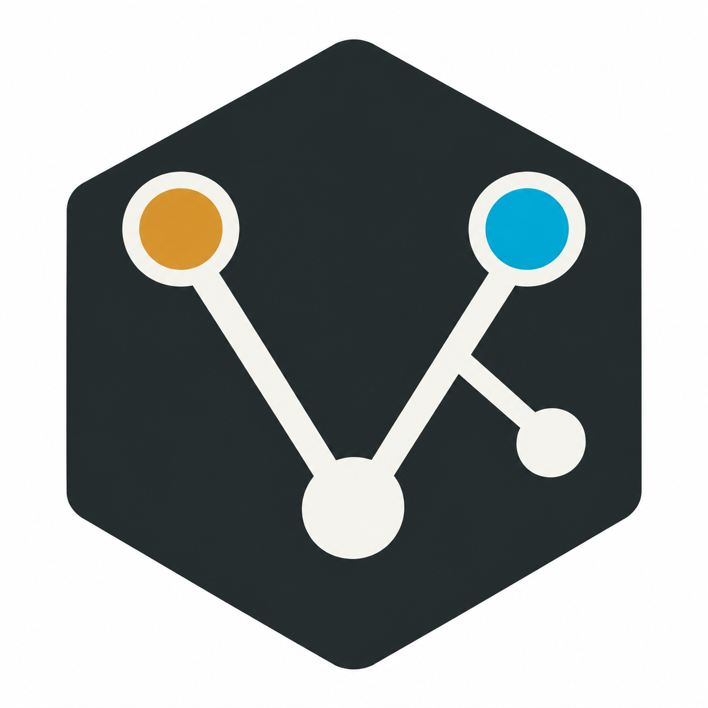
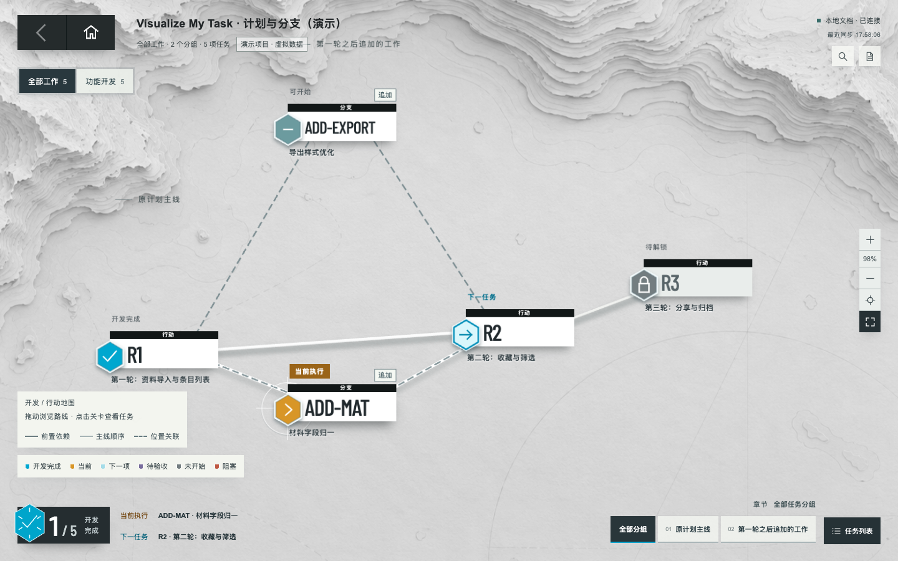
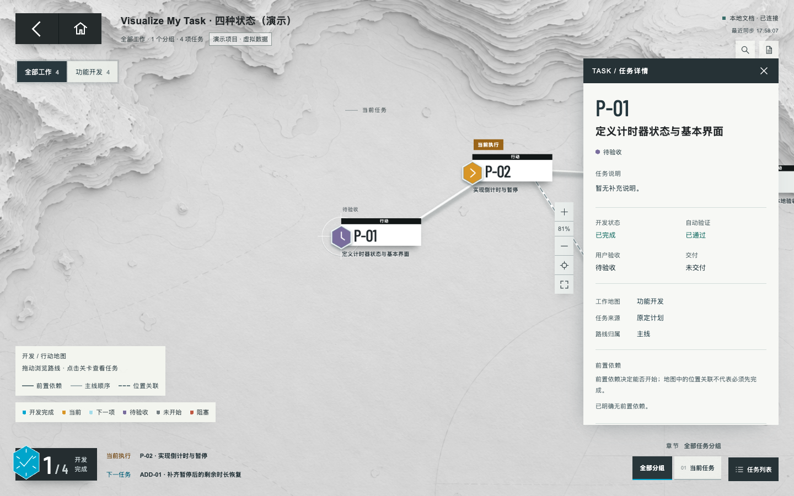
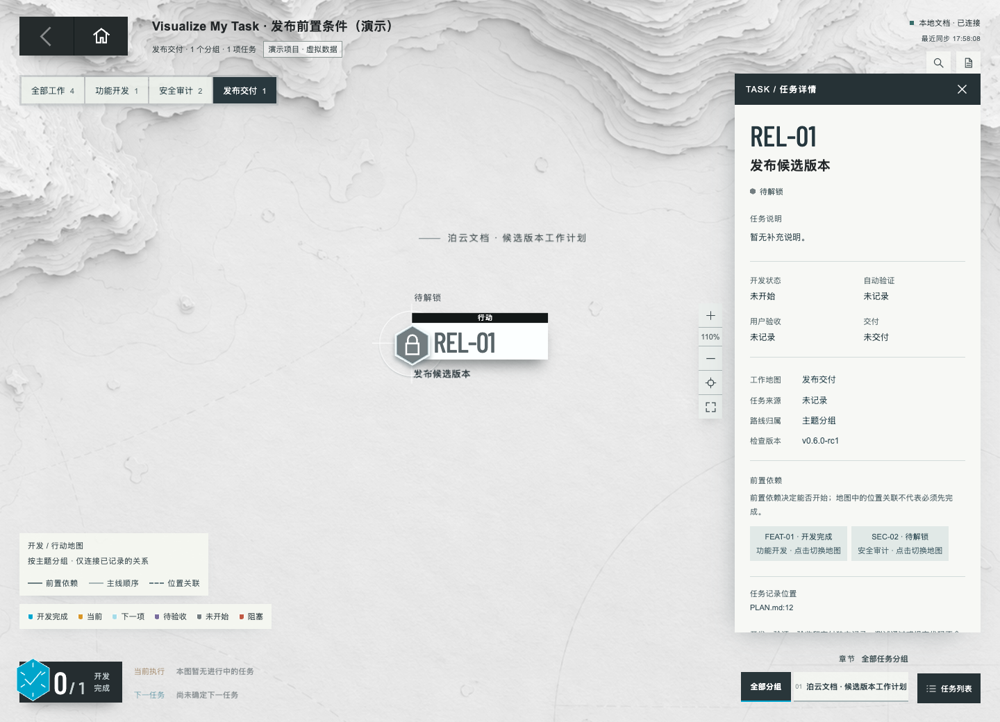
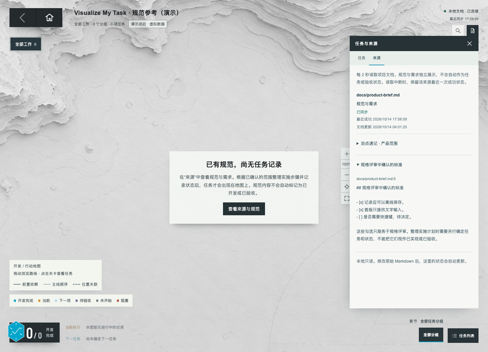
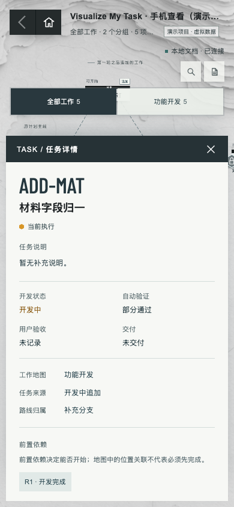

<p align="center">
  
</p>

<h1 align="center">Visualize My Task</h1>

<p align="center"><strong>“See the plan. Know your next move.”</strong><br>看清计划，走好下一步。</p>

<p align="center"><strong>简体中文</strong> · <a href="README.en.md">English</a></p>

**把 Markdown 开发计划，变成一张看得清的行动地图。**

正在做什么、下一步做什么、哪些工作还在等验收，打开看板就能看到。临时追加的任务也能接回原有路线。

`Codex Skill` · `中文 / English` · `本机运行` · `零第三方运行依赖`

[下载安装](https://github.com/AlexShen-Oguri/visualize-my-task/releases/tag/v1.0.0) · [快速开始](#快速开始) · [实际运行图](#实际运行图) · [案例说明](visualize-my-task/examples/cases/README.md)



*实际浏览器截图，使用随包的合成测试案例。两项追加工作都接在第一轮与第二轮之间，只有必要任务会阻塞第二轮。*

## 计划越来越长时，怎么跟得上

和 AI 一起开发时，计划里会不断增加任务：原定三轮开发中间补一项修复，再加一次检查，最后准备发布。读完文档仍要重新确认当前在哪一步，以及“写完”“测过”“验收过”各自是什么意思。

Visualize My Task 把这些记录放到同一张图里。你继续使用项目原有的 Markdown，Codex 在已授权的开发工作中维护计划，看板同步已保存的内容。

## 能帮你看清什么

| 你关心的事 | 看板怎么展示 |
| --- | --- |
| **现在该关注哪项工作** | 标出当前任务，以及有记录依据的下一步；可以定位、缩放、按章节浏览或搜索任务。 |
| **临时任务应该接在哪里** | 区分主线、必要支线和并行支线。地图位置与阻塞条件分别记录，原有任务编号可以保留。 |
| **测试通过，是否就算完成** | 开发、自动验证、用户验收、交付独立显示。通过测试的任务仍然可以等待验收、尚未交付。 |
| **开发、检查和发布之间有什么关系** | 切换开发、安全审计、发布交付地图；跨图前置任务仍能在详情中追踪，并保留候选版本范围。 |
| **项目已经有自己的文档结构** | 使用实际计划、规范和历史的位置。支持任务表、勾选清单、自定义文件路径和中英界面。 |

关系依据不足时，看板会保留未知状态或提示，不会把整份能力清单自动排成开发顺序。缺少任务记录时，也不会从规范中的勾选推断开发进度。

## 实际运行图

以下五张图均来自当前版本在本地浏览器中的实际运行，使用随包合成案例，不包含私人项目记录。点击图片可以查看大图。

### 开发完成、测试通过，还可以等待验收



图中的 `P-01` 已开发完成并通过自动验证，用户验收和交付仍单独记录。测试通过或推送代码，不会自动替你标记为已验收。

### 发布任务能追踪开发与检查的前置条件



`REL-01` 同时等待功能任务和安全复核。切换到发布地图后，依赖仍然保留；点击前置任务可以跳到它所在的地图。图中的 `v0.6.0-rc1` 是案例的候选版本。

### 只有规范，也能先查看参考资料



项目暂时只有规范时，可以阅读原始需求与验收标准。规范里的已勾选条目不会变成已完成任务；已有项目仅打开看板，也不会自动新建计划。

### 手机上查看当前工作



手机保留地图浏览和任务详情，可以查看当前任务、来源及状态。图中为 390 像素视口的浏览器测试。

## 快速开始

安装后，在你的项目里直接说：

```text
$visualize-my-task 打开这个项目的开发看板
```

1. **选对记录。** Codex 核对项目使用的计划、规范、历史与关系文档，沿用实际文件位置。
2. **打开看板。** 浏览当前任务、下一步、追加支线和独立状态。
3. **继续开发。** 在已授权的开发工作中维护原计划；所选文档保存后，看板每两秒同步一次。

也可以这样描述你的场景：

```text
$visualize-my-task 看看这份计划里，当前正在做什么，下一步是什么。

$visualize-my-task 这次追加的任务已记录在计划里，按已有依据整理关系并打开看板。

$visualize-my-task 从第一天为这个新项目建立并维护计划。
```

**本地服务只读。** 文档维护由 Codex 或单独的辅助脚本在授权范围内完成；看板服务不监听对话、不调用模型、不替你修改任务状态。

## 安装

需要 **Node.js 20+** 和本机浏览器。无需安装第三方运行依赖或执行构建。

1. 从 [v1.0.0 Release](https://github.com/AlexShen-Oguri/visualize-my-task/releases/tag/v1.0.0) 下载 `visualize-my-task-1.0.0.zip`；私有仓库需要访问权限。
2. 解压，将其中完整的 `visualize-my-task/` 放入 `~/.codex/skills/`。已有同名安装时先保留副本。
3. 在目标项目调用 `$visualize-my-task`。

克隆仓库时，安装的是仓库内的 **skill 子目录**。也可以先在仓库根目录预览随包案例：

```sh
git clone https://github.com/AlexShen-Oguri/visualize-my-task.git
cd visualize-my-task
npm start
```

终端会打印本机地址；默认展示合成案例，关闭启动进程即可停止服务。

## 哪些项目能用

| 项目情况 | 展示方式 |
| --- | --- |
| 已有分轮计划，开发中追加工作 | 保留主线，并按记录挂接必要任务或并行支线。 |
| 计划比较零散，只有近期目标 | 按主题分组，突出已记录的当前与近期工作。 |
| 暂时没有计划，或只有历史 | 显示空任务状态或变更历史，不自动制造进度。 |
| 开发、检查和发布同时推进 | 共用任务身份，分图查看并追踪跨图前置条件。 |
| 新项目，或文档放在自定义目录 | 可从首日维护计划，也能沿用自定义实施文档与规范位置。 |

界面可以跟随项目使用中文或英文；任务名称、说明和来源原文保持不变。全部合成场景见 [案例索引](visualize-my-task/examples/cases/README.md) 与 [语言案例](visualize-my-task/examples/cases/07-language/README.md)。

## 验证记录

`v1.0.0` 发布前完成了以下检查。本页截图另以当前运行版本重新拍摄，验证了五个展示场景和桌面／手机视口。

| 检查 | 结果 |
| --- | --- |
| 自动回归测试 | 101 项通过。 |
| HTTP、输入边界和浏览器安全检查 | 165 项通过。 |
| 安装包独立解压 | 101 项测试与 12 组 CLI 案例通过，包含中文和空格路径。 |
| 打包过滤 | 3 项实际集成测试通过；私人附加文件、符号链接与缺失文件得到相应处理。 |

这些结果覆盖随包案例和已检查的边界，不代表所有项目格式或所有浏览器均已验证。版本能力见 [发布说明](docs/releases/1.0.0.md)。

## 进一步使用

<details>
<summary>手动选择自己的计划、规范与历史</summary>

```sh
node ~/.codex/skills/visualize-my-task/scripts/board.mjs \
  --root "/path/to/project" --plan "docs/implementation.md" \
  --spec "docs/requirements.md" --changelog "docs/history.md" \
  --lang auto --check
```

确认来源与状态后，将 `--check` 替换为 `--port 0` 启动看板。`--plan`、`--spec`、`--changelog`、`--relations` 均可重复传入；路径相对 `--root` 解析。`--lang en` 或 `--lang zh` 可以覆盖界面语言。

文件名不决定角色：`spec/implementation.md` 可以是实施计划，而规范与历史作为参考资料。详见 [来源规则](visualize-my-task/references/project-sources.md)、[任务关系](visualize-my-task/references/task-relations.md) 和 [新项目工作流](visualize-my-task/references/new-project.md)。

</details>

<details>
<summary>本地运行与隐私边界</summary>

正常启动绑定 `127.0.0.1`，提供固定的只读 GET / HEAD 路由并校验 Host 和 Origin。不要通过代理或隧道暴露到公网。所选文档原文会显示在本机看板中，只选择需要展示的资料。

读取失败时保留最近一次成功快照并标记过期，重启后该内存快照消失。最多读取 16 个来源，每个来源上限为 2,000,000 字节、2,000 条记录。安全报告方式见 [SECURITY.md](SECURITY.md)。

</details>

<details>
<summary>运行测试与制作安装包</summary>

```sh
npm run check
npm test
npm run test:package
npm run package
```

打包需要 Python 3 与 Node.js 20+。安装包包含 skill 运行资源、测试、工作流参考和合成案例；README 展示图片只保存在仓库，不进入安装 ZIP。私人开发记录、旧 UI 和验证快照继续排除。字体许可见 [OFL-BarlowCondensed.txt](visualize-my-task/assets/OFL-BarlowCondensed.txt)。

</details>
